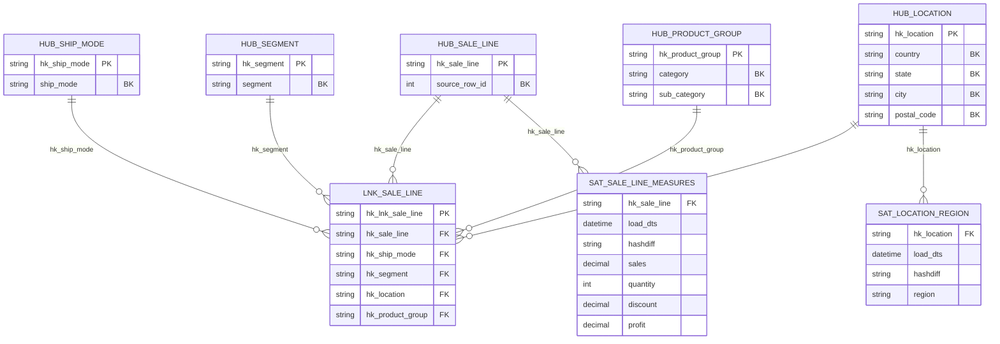

# Модель Data Vault — Superstore

## Исходные данные
`SampleSuperstore.csv` (Kaggle, roopacalistus/superstore): 13 колонок — Ship Mode, Segment, Country, City, State, Postal Code, Region, Category, Sub-Category, Sales, Quantity, Discount, Profit (около 9994 строк).
В этом наборе **нет** Order ID, Customer ID, Product ID и дат, поэтому классические хабы «Заказ / Клиент / Товар» построить нельзя. Модель опирается только на то, что есть в данных.

## Диаграмма

Бизнес-ключи (BK) помечены в комментариях к колонкам.

## Состав модели
| Тип | Таблица | Бизнес-ключ | Обоснование |
|---|---|---|---|
| Hub | hub_ship_mode | ship_mode | независимая сущность «способ доставки» |
| Hub | hub_segment | segment | сегмент клиентов |
| Hub | hub_location | country + state + city + postal_code | составной ключ, отдельного id места нет |
| Hub | hub_product_group | category + sub_category | подкатегория без категории неоднозначна |
| Hub | hub_sale_line | source_row_id | транзакция; Order ID в данных отсутствует |
| Link | lnk_sale_line | — | связывает позицию продажи с доставкой, сегментом, местом и товарной группой |
| Sat | sat_location_region | — | region описывает место, ключом не является |
| Sat | sat_sale_line_measures | — | меры sales, quantity, discount, profit |

## Принятые решения и ограничения
- **Хеш-ключи**: MD5 от нормализованного (trim + upper) бизнес-ключа, составные части склеены через `||`.
- **Меры лежат в спутнике хаба, а не в линке**: линк остаётся чистой связью.
- **Дубликаты строк** в источнике (если есть) сохраняются как разные транзакции, так как source_row_id уникален.
- **Postal Code** хранится строкой из 5 символов и дополняется нулями слева: в CSV индексы вроде 02110 могут быть записаны как 2110.
- **Целостность в ClickHouse**: FK и UNIQUE недоступны, вместо них — ReplacingMergeTree и проверки в `sql/04_checks.sql`.
- Модель не проверялась на реальном Greenplum; DDL для него — в `greenplum/ddl_greenplum.sql`.
